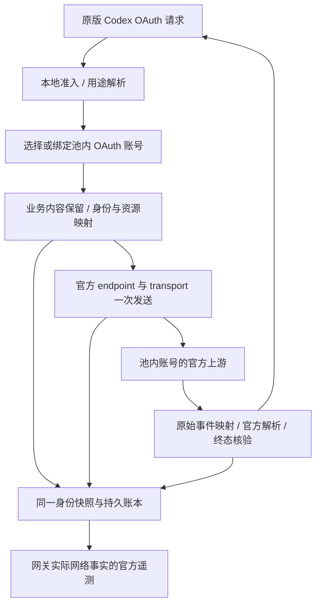

# right-codex：实施计划

## 公开发行（2026-10-10）

用户已授权将本项目源码公开到 `1198722360/right-codex`，并将运行镜像发布到 Docker Hub `wxyin/right-codex`；明确要求包含 x86_64。发行合同为 `linux/amd64` 与 `linux/arm64` 共用 `latest` 和 UTC 时间戳标签。采用 Apache-2.0，保留固定官方源码、原始许可和 NOTICE；账号凭据、配置、状态、私有审计原包及宿主个人指令不进入公开仓库。

已补齐多架构发布脚本、许可声明、直接拉取镜像的 Compose 与部署说明。准备发布时核对 Git 索引中的官方源码清单，分别检查双架构容器启动、ELF架构、健康接口与正常退出，再验证公开拉取和远端 manifest。当前发行尚在构建与核验阶段；不执行生产部署，E04–E08、E10 的未完成状态保持。最终发布回执在本节及验收清单更新，历史测试按原快照保留。

## 项目更名（2026-10-10）

用户已确定项目名为 `right-codex`，目录已迁移至 `<workspace>/right-codex`。Rust包与可执行文件改为 `right-codex`，库引用改为 `right_codex`；管理页标题、health项目标识、网关自有遥测来源名、Docker入口、维护脚本及现行文档同步更新。配置端口与既有协议保持原值；旧项目和官方vendor没有改名。历史镜像标签、原始验证日志与产物摘要保留其当时名称，不把旧证据改写成新构建。

当前目录、Git定位、Cargo锁定元数据、Compose配置、脚本语法及Rust格式检查已通过；改名后完整215项回归与macOS debug构建通过，实际进程启动验证了health项目名、管理页标题、准入及正常退出。证据见 `var/verification/right-codex-rename-tests.log`、`right-codex-rename-build.log`、`right-codex-rename-smoke.json`。此次未发布镜像或部署。

## 已确定的范围

本项目独立位于 `<workspace>/right-codex`；本文件是唯一当前实施计划，验收及清单也放在本项目。固定官方基线为 Codex `0.160.0` / `a956835d020762cb2b570053af06f643a11c0ecc`，源码来自固定 Git 对象的独立导出，不取来源仓库未提交文件。

用户已确定：客户端为原版 Codex，请求遵循其规范，使用默认 OpenAI provider，只改 `openai_base_url`；客户端登录账号与上游账号池均只考虑 **ChatGPT Pro OAuth**。其它套餐及 API Key 专用路线不属于设计、待办或验收，不为第三方客户端另建兼容层。不使用 Daybreak。历史回执保留原证据范围；未经套餐事实核对，不把已有OAuth测试自动重标为Pro测试。

**OAuth 范围判定必须沿实际入口核实。** 不把 API Key 专用功能列为待实现或待验，不因 SDK 定义同名接口就纳入范围。0.160.0 的 Realtime 须分开登记：原版 TUI 的语音入口明确选择 WebRTC，使用当前 provider 的 OAuth 认证创建通话；纯 WebSocket 分支另有 API Key 检查，在纯 OAuth 条件下本地拒绝，因此排除。OAuth WebRTC 的源码调用链已核实，真实账号通话权限和完整语音成功尚未验收，二者不能混写。

服务端是 Rust 纯协议网关，不启动 Codex TUI、daemon 或登录子进程。它接收客户端已经准备好的请求，隔离身份后使用官方网络库发送。工具执行、子代理调度、review、Memory、Guardian 的客户端工作及压缩历史准备仍在客户端完成；网关不重复执行、不制造 app-server 或审批事实。一个对话独占逻辑会话与连接状态，不再占一个 TUI。

旧生产仍是 0.155.1 拦截架构，未因本项目文档更新迁移。源码分析、设计、运行实现、构建、受控测试、官方差分、真实 OAuth 和部署分别记录。下面的目标合同按源码、受控测试与真实上游三类证据分别结算。

### 2026-10-10 全面复审结论

**计划尚未全部落实；协议隔离尚有待修项；客户端功能和各账号出站均未达到与原版 OAuth 完全等价。** 2026-10-10 已继续修复 E01 首次响应控制链、E02 回包协议身份、E03 遥测资源边界，前一快照完整172项通过，本轮错误策略完整197项回归通过；真实普通/工具等历史场仅证明各自快照。最新用户决定取消流中切号与网关自动重试；E01 原有切号握手标记缺口随这条路径退出范围，E09 改为单次发送及错误透传合同。E04–E08、E10 仍未完成；没有发布或部署。

前一快照验证分层：`p0-final-tests.log`为172项完整回归；`p0-final-clippy.log`记录最终严格检查；原版客户端控制消费者使用独立合成Pro、home和回环上游。当前macOS debug已构建，Linux镜像与真实OAuth仍为此前快照，未在本轮复建/复验；旧生产未改动。初次WS握手会真实预留账号与作用域，拒绝非法模型历史仅保证零模型发送，不承诺零连接开销。连接事实新增`state/connections`，其长期归档纳入E08。

目标分成三层：①已接入口的业务结果与原版客户端行为；②经过网关的协议身份隔离；③官方网络及遥测语义一致。账号池调度、身份重建属于用户选择的差异，不能同时承诺出站逐字节相同。客户端独立出口与本地账号门属于接入边界，不以伪造客户端事件或扩大到 API Key 模式填补。

## 错误与调度合同（2026-10-10 用户最新决定）

此决定替代所有“401自动刷新重发、429当前请求换号、流中续接”的旧方案。一次客户端业务请求只发一次上游；网关不重试、不切号重放、不合成续接请求。客户端自己的重试属于新的入站请求，独立记账。

| 实际上游结果 | 给客户端的结果 | 后续账号调度 |
| --- | --- | --- |
| HTTP 401，或 SSE/WS 错误包络明确为401 | 保留状态、业务错误正文及业务响应头，结束当前请求；WS交付错误后关闭 | 标记当前认证修订失效并持久化，立即停止新请求调度；重新导入实际新凭据后解除。单纯启用或同凭据重导不能解除 |
| 429且带有效的未来重置时间 | 原错误返回并结束，无本请求内重发 | 冷却至上游指定时刻；支持resets_at、resets_in_seconds、Retry-After及官方额度窗口重置头；Retry-After在收到响应头时固定倒计时，不因正文延迟重新起算。健康额度轮询不能提前清掉该冷却 |
| 429无重置时间、时间已过或格式无效 | 原错误返回并结束 | 不虚构60秒冷却，也不据错误文字猜重置时间 |
| 其余上游错误 | 原状态和业务错误返回并结束 | 不因该错误自行停号或切号重发 |
| 已交付文本或工具后出现错误 | 保留已交付内容，再交付原错误，结束该响应 | 不回滚、不接写、不重新执行工具；下一次客户端请求再按账号状态选择 |

这里的“原样”沿用既定协议隔离边界：业务内容和普通文字不改写；唯一请求/账号/路由标识等结构化协议身份仍剔除或映射。非JSON、二进制及空错误体保留原字节；截断错误体保留已读前缀并以正文中断结束，不补造完整响应。握手非101直接给客户端真实HTTP错误。现有WS不在原101下换账号或静默重拨；失去连接或账号资格后结束连接，由客户端新连接取得新握手控制信息。

失效状态绑定账号与实际访问凭据指纹，429冷却绑定账号并保存到私有admission账本；认证修订用于拒绝迟到旧错误。代理、base URL、文件格式或last_refresh变化不解除状态；更新实际access token只解除401，不提前清除同账号已确认的429冷却。内存先阻断调度，落盘失败记录日志且不覆盖真实上游错误；写盘失败时不承诺重启后保留。历史max_attempts配置仅兼容读取，不再控制业务重试。OAuth库显式凭据维护、客户端自身重试及私有遥测交付重试与业务请求重试分开。

实现、197项完整回归、严格Clippy、macOS debug构建及最终产物原版受控12案/4组消费者差分已完成；真实OAuth、Linux镜像、发布与部署未执行。详见本项目验收和审计。

## 只改模型 base URL：入口并非只有 Responses

配置覆盖的是默认 OpenAI model provider 的 URL，不是客户端所有网络出口。以下路径相对该 URL；例如配置 `http://127.0.0.1:18184/v1` 后，普通模型请求使用 `/v1/responses`。不更改 `chatgpt_base_url`、遥测 exporter 或登录地址。

| 请求 | OAuth 下的触发条件与去向 | 网关计划 |
| --- | --- | --- |
| `POST responses` / 同路径 WS | 普通轮次、辅助模型轮次、预热及 V2 压缩；默认 provider 支持 WS，实际传输另受启用、连接与 fallback 状态控制 | 核心入口，共用账号、身份、终态与遥测模块 |
| `GET models?client_version=…` | OAuth 模型目录刷新使用配置后的 provider；已有缓存或静态目录时不保证每次联网 | 必接，账号实际模型目录；版本参数使用网关固定 SDK 版本，保留目录业务内容 |
| `POST alpha/search` | 搜索已启用、namespace/搜索能力满足；模型 `use_responses_lite` 或 `standalone_web_search` 开关选择独立 `web.run` 执行器；否则 hosted search 随 Responses 请求 | 条件入口，共用发送与身份适配，不重新执行客户端工具 |
| `POST images/generations` / `images/edits` | Pro OAuth；已安装官方图片扩展，图片开关开启，provider 支持图片与 namespace，模型支持图片；默认 OpenAI 的准入门要求当前认证走 Codex backend，ChatGPT OAuth 满足该门 | 条件入口，共用账号与资源映射；按真实Pro账号核验上游权限 |
| WebRTC 的 `realtime/calls` 或 `live` | 创建使用 provider base；后续 sideband 默认直连 `api.openai.com` 并带客户端自己的认证，不受模型 base 控制 | 当前接入约束下在创建前返回双语 501，零上游创建；避免客户端将池内 call ID 与自身账号关联 |

图片接口不是仅凭 SDK 定义列入：已沿 `app-server/src/extensions.rs` 安装、`core/src/tools/spec_plan.rs::image_generation_available` 准入、扩展 backend 的 provider/auth 获取，以及 `ImagesClient::generate/edit` 实际发送串联核实。源码证明 OAuth 调用路径存在；不能据此保证任意账号都获私有上游授权。普通对话不自动发送图片请求，只有图片工具被选中并执行才发送。

这里的图片路径相对 ChatGPT Codex backend：未覆盖地址时，OAuth provider 默认前缀为 `https://chatgpt.com/backend-api/codex`，不是把公共模型 API 的认证规则套入同名路径。客户端配置网关 base 后，这些相对路径也拼到网关地址。

不把未调用的 SDK 方法当作必接入口：`ModelClient::summarize_memories` 的 `memories/trace_summarize` 方法当前全树仅查到定义与测试，尚未取得实际生产消费者证据。Memory 模型轮次按其实际 Responses 请求处理；不另造该接口调用。

其它出口单列：登录与刷新走官方认证地址；Analytics 使用独立 `chatgpt_base_url`；Statsig/OTel 使用独立 exporter；账号检查/额度、Memory 启动前额度检查和 MCP Apps 文件上传使用 `chatgpt_base_url`，上传还涉及签名 URL；插件/MCP/外部工具由客户端直接连接各自服务。只改模型 base URL 不将这些出口导向网关。默认 Realtime Websocket 在纯 OAuth 且没有 API Key 时本地报错，不发送请求；WebRTC/ExistingCall 不经过这个 API Key 门，不能把整个 Realtime 误列为 API Key 专用。固定源码 `core/src/realtime_conversation.rs` 与 `codex-api/src/endpoint/realtime_websocket/methods.rs` 所用控制连接另外选址。当前只改模型 base 的约束下，完整语音链路没有隔离闭环，公开入口在创建前阻断；SDK 局部测试不计完整语音支持。

官方 workspace 路由也有条件：默认 OpenAI 只有未设置 base URL，或 URL 以 `/backend-api/codex` 结尾，才满足 `supports_codex_backend_routes`。客户端接入前缀采用 `/v1`，避免无意进入该官方路由分支；服务端自己以账号池认证发现并绑定官方账号出口。后者必须使用池内账号，不能沿用客户端的路由、账号头或发现结果。

这个 workspace 改写属于 Responses/压缩/Responses WS 管线；models、搜索、图片使用各自 configured provider，Realtime 按其 transport/provider 规则选址。网关不能把 Responses 的已发现 origin 无条件套给所有端点，须按用途遵循各自官方 URL 选择。

逐项来源与资格见 [PROTOCOL-COVERAGE](docs/PROTOCOL-COVERAGE.md)。

## 请求识别：保留用途，不再重跑客户端

官方 canonical 元数据在 `body.client_metadata["x-codex-turn-metadata"]` 中，是 JSON 字符串。HTTP/WS headers 及平铺 metadata 是其兼容投影，不能把各投影分别当成独立真相。官方 `request_kind` 只有 `turn`、`prewarm`、`compaction`、`memory`；review、子代理、Guardian 等用途还要结合源码规定的 subagent/专用标记，不能仅凭提示词猜测。

| 已收到的请求 | 服务端执行流程 |
| --- | --- |
| 普通对话、标题、review、子代理 | 标题为 `turn` 加 `thread_source:thread_title`；review/子代理还有 `x-openai-subagent:review/collab_spawn`。保留模型、input、instructions、tools、reasoning、text 等业务语义；映射身份后发送一次。客户端继续处理结果和本地工具 |
| `prewarm` | WS 使用 `generate:false`；保留官方非推理预热语义，建立本会话连接状态；不登记为用户已经完成一轮对话 |
| V2 `compaction` | 保留客户端已准备的历史及末尾 `compaction_trigger`；转发流，核验一个 Compaction 输出与实际完成事件；不再次裁剪历史、添加提示或启动第二次压缩 |
| `memory` 及其实际辅助轮次 | 提取用 `memory`；整合另有普通轮加 `thread_source:memory_consolidation`、`x-openai-memgen-request:true`。遵循各 kind 的 metadata 形状及实际线程身份省略规则；不强塞普通对话的线程字段；不启动服务端 Memory 工具执行器 |
| Guardian | `x-codex-guardian:reviewer/classifier`，Reviewer 另有 `thread_source:guardian_review`。保留用途标记与授权语义；父响应关联仅引用同一账号/认证/会话作用域的本网关来源；不为缺失客户端审批事实编造裁决 |
| 独立搜索、图片 | 按相应官方 endpoint 类型发送，仍走共同账号/身份/网络账本；图片引用另走资源来源核验 |

这些分类用于正确选 endpoint、作用域和遥测规则。它不意味着收到一个 Responses 请求就重放完整 Codex 会话生命周期。规范客户端请求也不提供其所有本地执行事实。

## 七个模块及复用边界

| 模块 | 技术细节 | 复用官方源码的方式 |
| --- | --- | --- |
| 1. 接入与分类 | 接收规范 JSON/WS，保留业务字段与未破坏语义的扩展；统一解析 canonical metadata，登记本地会话/用途/取消。客户端凭据仅用于本地准入，绝不发给池内账号上游 | `protocol/src/models.rs`、`codex-api/src/common.rs` 公共类型；`core/src/responses_metadata.rs` 的纯规则是 crate-private，需窄提取、保留来源及差分测试 |
| 2. OAuth 账号池 | 每账号独立凭据目录、代理、认证修订、连接与额度状态；PKCE/Device 登录、显式刷新串行门、401停调度、删除排空、休息与新会话选择 | `codex-login` 的公开登录/认证接口；只调用库，不启动登录进程；resolver、持久化及账号绑定由网关明确接入 |
| 3. 会话与身份 | 本地客户端会话映射到账号代次内上游会话；item/call/response/file 分开映射。完整校验成功再提交，重启后只接受有持久证据的映射 | 官方字段类型与元数据投影规则；网关维护自己的身份/密文/资源来源账本 |
| 4. 官方网络发送 | 按用途创建 provider/auth/endpoint；官方 JSON 编码、压缩、HTTP/SSE/WS；按用户合同关闭业务重试，保留实际错误字节和响应头，更新401失效/429冷却后结束 | `Provider`、`EncodedJsonBody`、`ReqwestTransport`、`ResponsesClient`、`ModelsClient`、`SearchClient`、`ImagesClient` 及公开 telemetry hooks；core 的流恢复/中断纯规则需窄提取 |
| 5. 流转交与资源 | 同一次上游发送保存原始 SSE/WS 事件，仅改已列明身份字段；反向映射后实时交付。完成、失败、中断、EOF 分列；图片/file_id 同号证明或有源字节后跨号重建 | 官方 parser 驱动事件语义；原始 wire 另留有界观察通道，不能把内部 `ResponseEvent` 重序列化冒完整原始事件 |
| 6. 遥测 | 实际发送点产生请求、重试、状态、耗时、帧、用量及响应身份事实；按同一出站身份快照建立官方网络指标/日志，迟到事件仍归原 attempt | 公开 `RequestTelemetry`、`SseTelemetry`、`WebsocketTelemetry` 与 `SessionTelemetry`；显式注入分账号 metrics，不直接借默认全局实例 |
| 7. 持久账本与管理 | 保存账号代次、输入快照、提交/未知/终态、已交付内容、ID/密文/资源证明、遥测交付。管理界面显示真实状态；提供排空、备份与受控升级 | 独立网关业务模块；不搬运旧 TUI/RPC 来源门，不将旧测试成绩计入新路线 |

`ResponsesClient::stream_request/stream` 返回官方内部 `ResponseStream`，其中 Completed 事件仅保留部分字段，不能据此复原完整 `response.output` 和任意 wire 扩展。采用 transport 观察适配器：一份真实上游流供官方解析与原始事件转交，使用有界队列和统一取消；不能为了解析再次调用模型。本轮已接入该适配器并通过受控 HTTP 测试；原始 SSE 交付在本事件的官方 hook 已观察后再关闭 attempt，防止双观察通道抢先结算而丢遥测。

## 一次普通请求怎么走

1. 从规范请求取得业务内容、本地会话关系和用途；这些客户端 ID 只用于本地查找。完成准入后选择启用且有额度的账号，已有会话继续使用其绑定。
2. 冻结账号、认证修订、官方路由代次、逻辑会话、attempt。该快照同时供出站请求、响应转交和网关遥测使用，之后切号也不修改旧快照。
3. 原样保留对响应有影响的业务内容；创建本代次的 thread/turn/window/cache/trace 等身份，重建 canonical metadata 和对应 headers。只在官方定义的身份字段改写，不递归改用户文本、工具参数或任意自由 JSON。
4. 用所选账号的 OAuth token、账号头、代理与当前官方路由创建请求。客户端 Authorization、ChatGPT-Account-ID、UA/originator、sticky、cookie 和外部 trace 不直接透传；出口 UA/版本/平台按本网关固定 SDK 与真实宿主构造。
5. 官方 transport 实际发送；记录真实请求摘要和网络事实。SSE/WS 收到后映射上游 ID 为客户端侧 ID，再实时交付；本地工具仍在客户端执行。
6. 完成/失败/中断/未知分别结算，释放串行门和连接状态；只给已确认来源的数据授予复用证明，不把 EOF 或取消当 completed。
7. 使用步骤 2 的快照与步骤 5–6 的真实事实生成网关网络遥测。遥测中的用途、身份、状态与用量必须对应已发送的请求，不由客户端原 ID 或估计工具耗时填充。

### 仅改 base URL 的接入认证缺口

源码已确认：保留客户端 ChatGPT OAuth 登录只改 URL，Authorization 仍来自客户端 OAuth token，账号头也仍来自客户端认证。不会自动变成网关固定 Key。网关必须丢弃这些出站凭据并使用池内 OAuth，不能把客户端 OAuth 当池内账号导入。

本轮采用操作员明确配置的可信网络准入：默认仅 loopback，依据实际 socket peer 和 CIDR，忽略转发头。Bearer 格式只核对原生请求形状，不视为身份认证；客户端账号头仅作网关私有域内会话命名。管理 token 单独保护管理入口，不要求客户端增加配置或切 API Key 模式。部署在可信网络之外时须先配置网络准入边界。该合同已接代码；原版 OAuth 客户端已穿过本地准入并到达真实上游，完整成功轮次仍按下文验收记录。

## Codex2API 三个管理接口（2026-10-10）

用户已要求实现，并明确本轮不做 iOS 联合验证；协议参考 `<reference>/codex2api` 的 `admin/oauth.go` 与 `admin/handler.go`。此处是账号授权/状态管理，不扩大原版 Codex 模型客户端范围，不修改 Responses、账号隔离或错误透传合同。原 iOS 项目仅作前轮字段需求来源，本轮不修改或运行它。

| 入口 | 合同 |
| --- | --- |
| `POST /api/admin/oauth/generate-auth-url` | `proxy_url`、可选 `redirect_uri`；返回 `auth_url/session_id/expires_in_seconds` |
| `POST /api/admin/oauth/exchange-code` | session_id/code/state，加可选 name/proxy_url；返回正整数 id、email、plan_type、updated、message |
| `GET /api/admin/accounts?view=lite&channel=codex` | 返回 accounts 数组，含稳定整数 id、name、email、plan_type、status、enabled；不返回凭据/代理密码，不触发用量或恢复探测 |

三个入口接受 `X-Admin-Key`，该头缺省时支持原Codex2API的管理Bearer回退，均验证现有 `admin_token`；既有 `/admin/api` 的 Bearer 规则不变，模型入口不接受该头作为网络准入替代。实现复用 `OAuthLogin::begin_browser` 和 `BrowserLogin::complete`，不另造官方 OAuth 流程、不启动本地回调监听。默认 redirect 为 `http://localhost:1455/auth/callback`，显式自定义仅接受官方 loopback 的1455/1457端口及固定路径。

会话各自绑定 PKCE、state、代理与15分钟有效期；内存会话在重启后失效。空代理表示直连，不继承环境/全局代理；兑换省略代理则沿用准备阶段，显式代理须匹配该会话。授权码一次兑换；重复的同码提交读取原结果，正在兑换返回409和Retry-After，换码重复提交拒绝。请求连接断开不取消已开始的一次性兑换；失去进程后的未知结果不自动重放。兑换成功后若导入或整数ID回执落盘失败，保留私有暂存凭据或已注册阶段；同一session在有效期内重试只补做本地步骤，保持原created/updated结果，不重复token POST。

正整数管理别名存入私有 `codex2api-ids.json`，重启保持，已删除账号的别名不复用。邮箱/套餐取自官方OAuth响应凭据解析，name仅作本地标签；新接入只接受Pro。重复 workspace 更新既有账号，保留内部ID、管理启用状态、活动请求旧快照和有效429冷却；只有实际新访问凭据解除401。删除排空中的账号拒绝更新，不按邮箱合并不同 workspace。

与参考实现的明确差异：本项目限定Pro、保留15分钟原生登录期限、限制回调地址、冻结会话代理、空值直连会清除重授权账号的旧代理、不继承全局代理、不在失败后重兑同一授权码；列表只实现lite/codex投影，不返回原接口的带密码proxy_url，以proxy_configured表示绑定状态；包含at_only/agent_identity等安全类型标记。未接入参考项目其它厂商、分页/完整探测视图或管理模块。接口字段兼容不代表复制整个Codex2API服务。

当前：三个接口及账号更新已实现。完整215项回归、严格Clippy、macOS debug构建与格式检查通过；新增18项中含10项服务端集成测试，覆盖认证、PKCE/实际代理传输、错误state/到期/重放/并发与断线、稳定整数ID、重复授权、排空删除、重启、状态映射及两种存储故障恢复。证据为 `var/verification/codex2api-tests-final.log`、`codex2api-clippy.log`、`codex2api-build.log`，来源与二进制摘要见 `codex2api-manifest.json`。按用户范围不执行iOS验证或真实人工授权，未构建Linux镜像、未部署。持久化为逐文件原子写入；受控普通写入失败会回滚，不宣称跨文件进程崩溃事务。

## 当前选号顺序（2026-10-10 源码核对）

这里描述已实现的`AccountPool::next_eligible_excluding`、`Conversation::account`与`AppState::reserve`，不把配置示例当作部署实际值。

1. 已有会话优先尝试当前绑定账号；规范子会话首次建立时，优先继承同私有namespace中父会话的账号及认证修订，再经过实际调度资格检查。不是每条消息都重新轮询。
2. 新会话没有父绑定，或原绑定不再满足调度条件时，以全局递增游标决定账号列表扫描起点，向后寻找第一个满足条件的账号。不会按剩余额度、余额百分比或当前负载排序；扫描跳过的账号不使游标直接定位到本次选中账号之后，因此不承诺动态筛选下严格等量分配。
3. 资格包括管理员启用、未删除排空、未因401标记失效、未处于有效额度冷却、并发请求数未达上限；新会话还受休息与五档账号年龄会话上限约束。休息不阻断仍保有活动占位的既有会话；空闲占位回收后再次使用按新占位处理。
4. 新会话占位按同账号启动间隔串行排队；最终取请求lease时再次检查资格和认证修订。发送前不满足条件或排队超时时尝试其它候选，这不是上游报错后的重发。同一逻辑会话请求通过独占锁串行，排队有超时。
5. 已有WS连接绑定其握手账号；若新一轮的调度结果与该绑定不一致，返回503并关闭，等客户端重新建连接取得新握手，不在原101下隐式换账号。已经开始的业务请求遇到上游错误仍按前文返回并结束。
6. 没有满足条件的账号返回503和Retry-After；429有有效重置时间才冷却，401停调度。60秒usage查询更新额度状态，但不清掉未到期的实际429冷却；查询结果不用于账号权重排序。

无会话身份的原生models请求也使用同一个轮转游标，独立于对话绑定；带已知身份的搜索/图片按其会话归属选择。目录账号与最终模型请求账号的资格一致性仍是E07待办。当前纯协议实现限制的是逻辑会话和并发请求，不启动TUI。本轮仅补充源码已核行为说明，未改变选号实现、重跑构建或部署。

## 隔离、换号与中途加入

| 条件 | 处理结果 |
| --- | --- |
| 同号、同认证/会话来源的 ID 和密文 | 按账本沿用对应上游对象，保持工具/响应关联；本地映射仅在该作用域有效 |
| 客户端旧服务或未获本网关证明的 ID | 创建新的上游身份；旧 ID 不向上游外发，不能拿其前缀或字符串形状当来源证明 |
| 外部 reasoning 密文 | 删除外部密文，保留已有明文语义；没有明文的内容不冒称已恢复 |
| 中途加入且带完整明文历史 | 建立新的上游会话、重映射历史工具/响应身份；不发送旧缓存、路由、线程、父响应与密文 |
| 只有外部加密 compaction 或 file_id，缺明文/文件字节 | 尚无重建来源，不能声称完整无损接续；记录缺条件，不能盲发或伪造解密 |
| 429 / 额度耗尽，另有可用账号 | 当前请求返回原错误并结束；下一次客户端独立请求重新选账号，创建新认证/路由/连接/缓存/trace/资源代次，不复用旧账号身份 |
| 已实时交付部分文本/工具 | 原错误交付后结束，不做流中切号、续接或工具重放 |
| 已发送而提交结果不明 | 登记 unknown；结合客户端恢复状态与已交付账本决定后续，不能把未知 attempt 简化为未发送后无条件重试 |

每账号的唯一 installation/process/thread/turn/window/cache/trace 与遥测资源不得作为跨号关联键。认证刷新、账户更换、代理与官方路由改变都建立明确代次，旧 attempt 迟到事件留在旧账本。文件只有源字节取得并在目标账号重建后才建立新号引用。

上述隔离承诺针对本网关向池内账号发送的流量。客户端独立直发 Analytics/OTel 不受模型 base URL 控制；仅靠这个网关不能改写或消除这些直发事件中的客户端身份。公开源码没有私有服务端识别规则，不能保证上游绝对无法区分实现。

## 遥测做到什么，不制造什么

公开官方网络 hooks 和 `SessionTelemetry` 支持记录实际 API、SSE、WS 与完成用量；这些事实来自网关本次真实网络动作，是当前实施目标。不同账号的实例、资源属性、批次和交付都按各自作用域隔离，不能把默认全局 metrics 单例直接当已隔离。

私有 collector 是自有网络事实的独立出口，采用至少一次投递。接收端须按稳定的 `account_key`＋`fact_id` 去重；批次重组时仅凭批次 `idempotency-key` 不足以跨分批防重。HTTP 2xx 只证明请求获得成功状态，不证明逐条事实已经消费。正式后台发送在取得导出锁后与 POST 前核验账号状态；停用且没有活动请求或删除排空完成时暂停，重新启用同一认证修订后恢复。官方指标则在 POST 前持久标记 attempted，未知结果不重发。两路交付语义分别显示，不混称。

Analytics 是另一层。公开 `AnalyticsEventsClient::track_*` 接收 app-server 请求/响应/通知及部分自定义事实；`AnalyticsFact`、`AnalyticsReducer`、内部事件结构是 crate-private，不能宣称外部直接调用 reducer 就获得完整原生生命周期。规范 Responses 请求仍没有客户端工具开始/结束/耗时、审批、用户操作、完整配置和本地历史计量。`function_call_output` 只证明网关收到该内容，不证明真实执行过程。

仅在网关具有完整真实来源时适配对应 Analytics 事件；缺事实不发送或明确登记 unknown，不制造客户端 RPC/通知凑齐。35 类事件与 195 项指标目录是源码资料，不是每轮必须发送数量。客户端原有遥测仍按其独立配置发送；不新增客户端采集器的约束保持。

## 优先级与验收办法

| 优先级 | 下一项实际交付 | 当前状态 |
| --- | --- | --- |
| P0-1 | OAuth 原版客户端准入、业务字段与 canonical metadata、Direct 输出、官方 endpoint 与原始流 | 核心已接线；真实普通/工具/搜索/子代理/resume/review/V2 已通过。首次响应控制头和回包协议身份已受控修复，真实双Pro及其余收尾项未验，不能标整体完成 |
| P0-2 | OAuth 登录/凭据维护/401停调度、账号路由、HTTP/WS 预热/中断/恢复/V2 | 已实现，真实账号发现并修正 NO_CONSTRAINT 路由；登录/协议故障测试与真实联合分别验收 |
| P0-3 | models、搜索/图片、资源来源与镜像、额度切号、持久恢复 | 主路径已接线；真实图片输入、独立生成/编辑及后续对话通过，辅助接口改为401/429原错误返回并结束。模型目录选号与业务选号未绑定、长期attempt上限和真实双OAuth切号仍未闭合；OAuth WebRTC创建前501 |
| P0-4 | 官方网络遥测按出站身份对齐、每账号指标与交付账本 | 逐账号网络事实、完成用量、exporter、清空及整链受控场通过；官方事件分类/标签仍有差异，环境resource隔离已修并通过新批次/冷队列受控验证。不能把接入hook记为完整原生遥测等价；客户端缺来源事件仍不补造 |
| P1 | 管理、容量/排队/休息/删除排空，容器及备份部署 | 管理与持久调度、单服务 Docker/Compose 已实现；最终源码双架构smoke、真实Linux Release、备份恢复已通过，未发布部署 |

### 复审后的具体收尾顺序

以下均为当前实现与固定源码核出的项，不把尚未发生的私有服务端行为当作证据。E01–E03优先解决协议控制数据和身份出口；其余按影响范围并行，冻结公共依赖后统一测试。

| 编号/优先级 | 已核条件与结果 | 计划修正与完成标准 |
| --- | --- | --- |
| E01 / P0（按最新合同收尾） | HTTP成功/错误按实际响应投影业务控制头；/models保留真实ETag；WS在下游101之前完成实际上游握手，首个426直接返回HTTP。模型/推理/额度/ETag/安全处理的固定原版消费者对照已通过。源：`src/response_projection.rs`、`src/gateway.rs`、`src/auxiliary.rs`、`src/websocket.rs` | 初始握手控制投影保留；取消流中切号、同一下游101内的静默重拨与账号替换。错误交付后断开；下一独立连接获得新握手头。原先跨号重用初始推理标记的问题随路径删除退出范围，单次发送/关闭/新连接受控验收 |
| E02 / P0（已实现，受控通过） | 新响应投影只处理帧顶层、response/error及其协议metadata/headers；剔除request-id/cf-ray/路由/sticky等独有字段，响应/item/call/previous-response按当前会话事务映射。HTTP嵌套错误及WS握手错误共用投影，非对象/二进制/空错误体保留原字节与真实HTTP状态。文本/参数/任意工具输出JSON原样 | 8项专用测试与真实HTTP/WS路由反例通过，含失败回滚、跨账号/认证修订、后续重用和官方库业务消费者差分。固定原版400及403重连的RPC/trace哨兵反例已通过，业务说明/code/status保持；不将默认关闭的OTel日志出口写成默认Analytics泄漏，不推断私有服务端关联 |
| E03 / P0（受控闭合） | 官方SDK的Resource::builder同时收集环境且环境会覆盖SDK字段，不能从旧snapshot挑白名单。现从官方TelemetryResourceDetector、固定版本、真实originator/env和os_info重建资源，整个resource/schema替换；新入队与所有冷pending重发共用发送前边界 | 独立子进程注入唯一环境哨兵与伪静态字段，两个合成Pro实际收包；Custom protobuf、Statsig JSON、官方URL配置的冷队列均经受控回环验证。无共享host/process/安装ID，无修改全局环境；账号归属在私有指标实例/队列/传输。公网Statsig和真实双Pro未重验 |
| E04 / P1 | 同账号认证不变而官方origin/override改变时，Session没有独立路由代次；HTTP沿用身份/sticky，WS绑定也不核路由。`src/routing.rs:110–115,154–158`、`src/gateway.rs:495–501,790–813`、`src/websocket.rs:175–183,835–883`；原426缓存已删除 | 将有效路由指纹绑定发送快照及连接；路由改变时按合同废弃旧连接/sticky及依赖该出口的来源。验证双origin、仅override改变、HTTP/WS复用/重连和迟到事件。这是同账号跨路由状态问题，不写成已发现跨账号泄漏 |
| E05 / P1 | 目前用官方指标名记录缩减后的标签：SSE allowlist外归other、EOF记end成功；WS按text/binary帧分类，未按官方JSON事件与时序解析；metadata tags被整体省略；本轮取消401恢复，不再要求该路径标签。`src/observability.rs:819–833,946–1068`。终态后hook被账本拒收且调用方忽略错误，指标仍归原实例；不是所有迟到事实都已持久保存（`src/telemetry.rs:473–479`、`src/gateway.rs:742–744`） | 逐项对齐真实网络事实的官方分类、成功/失败口径、标签与时序；增加原attempt终态后观测记录，不污染下一attempt。省略/改写须有身份规则与差分证据。保留真实网关source，不冒充原生工具执行；完整客户端Analytics仍不补造 |
| E06 / P1 | 当前HTTP在yield前、WS在send前预记“delivered”；它不证明socket写入或客户端收到。`src/gateway.rs:1148–1159`、`src/websocket.rs:612–645` | 区分提交交付、socket写入结果和客户端执行事实；增加预记后发送失败/进程退出/恢复防重场。SSE没有端到端确认，保留unknown，不能把“没有重复”同时表述为“绝不漏交付” |
| E07 / P1 | 原版GET models无会话头，网关轮询目录账号；Responses又独立绑定账号。未建立两个Pro账号之间的目录资格一致证明。`src/auxiliary.rs:443–451`、`src/gateway.rs:367–380`；官方`model-provider/src/models_endpoint.rs:163–165` | 设计目录与模型选号的一致规则：向客户端暴露的模型须有池内资格来源，业务按模型资格选/换号，失效目录触发刷新。用合成Pro资格与不同目录做负例，再以真实双Pro补验；不引入其它套餐兼容 |
| E08 / P1 | 每scope累计attempt上限256；已完成attempt没有冷归档或裁剪，切号及重启保留它们。到限后prepare持续返回容量错误。`src/session.rs:24,486–487,847–883,1806–1864` | 设计终态冷归档与活动恢复索引，保留unknown、密文/资源来源及工具抑制的依赖证据；验证超过256次请求、压缩、换号、重启后继续。仅增加数字上限不能代替生命周期方案 |
| E09 / 用户差异（受控合同通过） | 用户明确要求上游错误直接返回，网关不自动重试、刷新或切号续接；这与官方部分重试策略是已选择的差异 | HTTP/SSE/WS与辅助入口各自证明一次客户端请求只有一次业务发送；真实错误状态/字节/业务头保留，401停调度、429仅按有效重置时间冷却。客户端自行重试单列为新入站请求，不再以恢复官方自动重试为待办 |
| E10 / 验收门 | 第二个不同真实Pro OAuth账号、历史真实场的Pro套餐证据核对、Memory阶段1逐请求归属/有效输出、真实新增账号授权、长期压力、跨版本/损坏备份及生产部署未完成 | 继续保留独立待验项，代码修正后按影响范围补测试；不存在第二真实Pro账号时只结算受控切号，不标真实双Pro通过 |

### 仅改 base URL 的固有限制

- 客户端Pro账号A与池内Pro账号B的额度仍是两份独立状态：官方`memories/write/src/guard.rs:21–39`查询A自身额度并决定是否启动Memory。若A未满足剩余额度阈值，即使B额度充足，该轮Memory也不会到网关；两者均为Pro不消除这个本地门。客户端额度页面、登录状态也不变成池账号状态。其它套餐的图片资格差异已从缺口中移除。
- OAuth Apps Files上传、Analytics/OTel及外部工具不由模型base代理；缺文件字节、纯外来密文、中途只带不可读历史时没有无损重建证据。普通图片/本地文件读取通过不等于Apps Files全链成功。
- OAuth WebRTC是真实客户端入口，但其sideband不随模型base统一选址；当前网关仍在创建前501。需要API Key的纯WebSocket已排除，不列待办。若坚持现有接入约束，语音保持明确不支持，不能列为“功能完全无异”。
- 用户已取消实时输出后的切号续接；已送出的内容保留，原错误交付后结束。未知提交和客户端实际执行未有确认时，不承诺零漏交付和完整执行事实。提示词正文里的ID/目录仍按用户要求原样保留。

验收只比较已选 OAuth 条件：固定官方参考端与网关使用同一规范请求及受控上游，逐项比较 URL/method/headers/业务 body、压缩、原始 SSE/WS 事件、重试/取消/终态与遥测。动态时间/ID/token 采用明确映射关系核验，不能整体删除字段凑一致。官方二进制仅在隔离测试运行，不进入产品依赖。

故障注入覆盖 401/429/5xx、Retry-After、分片错误体、半帧/EOF、取消/中断、迟到流、未知提交、重启/认证/代理/路由变化；专项验证工具交付后报错结束、下一独立请求换号及中途加入。真实客户端 ordinary/compact/search/subagent/resume/review/图片文件与真实双 OAuth 联合单独结算，使用独立 home，宿主 auth 只读。

防遗漏从实际消费者双向追到 endpoint/transport：每一 OAuth 调用记录注册、feature、模型能力、账号条件、URL 来源、身份字段及测试。SDK 中无消费者的方法单列；不靠字符串扫描、成功响应或测试数量宣称零遗漏。新版只审查固定源码增量，共同依赖冻结后批量构建，继承输入未变的证据，避免每模块重复全量编译。

## 当前实现与验证记录（2026-10-10）

首段历史成绩只作历史参考，见 [HTTP-FOUNDATION-AUDIT](docs/HTTP-FOUNDATION-AUDIT.md)。现行实现已经替换固定模型 Key、纯内存状态和有限请求投影，不再沿用这些被替代的原型描述。

- OAuth：逐账号私有 home、PKCE 真实 1455/1457 loopback 回调、Device 登录/轮询/取消/到期、串行刷新、每账号代理及官方 custom CA。PKCE 浏览器需在网关宿主机；远程操作采用 Device。宿主导入凭据只读。
- 会话：原子 prepare/commit、持久来源、unknown/终态、ID/密文/资源证明和已交付工具账本。客户端 turn 只作本地防重键，出站 turn 按账号另建；重启不将 Sending 当作未发送。空闲回收不删除持久证据。
- 业务：HTTP/SSE 及 WS、预热、interrupt、426 回退、V2、模型目录、条件搜索/图片已接线。HTTP/WS 401/429/其它错误原样交付后结束；网关不自动重试、刷新或流中换号。候选探测不再推进轮询指针。
- 资源：生成图片的实际源字节存于私有同会话仓库，返回本地 generation alias；编辑解析别名后校 SHA/MIME，改用 Inline。外部无源 file_id 不能转发或虚构下载。Realtime call 创建前返回 501，避免池内 call ID 由客户端自身 OAuth 直发 sideband。
- 遥测：官方 Request/SSE/WS hooks、逐账号 MetricsClient、实际完成 usage histogram、持久 pending/attempted 交付与清空。只向已知账号自己的出口发送；未知发送结果不重投。私有网络事实与官方指标分开记账，不冒称完整客户端 Analytics/Trace。
- 调度与管理：账号 CRUD/排空删除、五档会话容量、空闲回收、启动间隔、随机休息、管理 UI/API、私有事实与遥测交付列表。每 60 秒并发至多 4 个账号检查真实额度；失败保留旧额度；真实401停止账号调度，真实429带有效重置时间时写入独立冷却，不用错误响应虚构额度为零。
- 部署文件：纯 Rust 单服务 Dockerfile/Compose/deploy.sh 已写；没有 TUI、守护进程、MITM CA 或额外数据库。未替换旧生产、未推镜像、未远端部署。

前一快照完整172项回归与严格Clippy通过，日志为`p0-final-tests.log`及`p0-final-clippy.log`；固定原版控制消费者与资源隔离结果见上文E01–E03及审计文档。此前158项快照的构成为 lib 46、OAuth 15、辅助接口 15、整链遥测 1、HTTP 14、metadata 11、网络遥测 7、正文保留 3、身份隔离 32、WS 14；日志为 `var/verification/plaintext-contract-tests.log` 与 `plaintext-contract-clippy.log`，构建日志为 `plaintext-contract-build.log`。Edit响应同样映射本地generation alias，生成→编辑→再次编辑包含在本次15项辅助测试中。固定依赖自身仍有未使用patch与future-incompat提示，未修改官方源码消除提示。

此前真实 OAuth 已验证原版 0.160.0 二进制独立安装、宿主 auth 全程只读、模型目录与官方账号路由。普通对话、工具往返、搜索、子代理实际执行、resume、V2 压缩及后续轮、review、图片输入、本地文件、中途接入分别通过；搜索与子代理最后重跑记录为 `real-final-search-subagent.json`，含实际工具/子线程证据，不只看最终文本。此前失败回执保留，当前结论见 [IMPLEMENTATION-AUDIT](docs/IMPLEMENTATION-AUDIT.md)。

固定资源限制需要明确：请求 64 MiB；逻辑会话缓存至多 4096；每会话 attempt/来源/历史另有界限并显式报错，unknown 不静默驱逐。长期运行、超长对话、超过界限的历史迁移仍须压力验收，不写成无限保留保证。

### 本轮收尾合同与剩余验收

- 父协作任务密文：仅从同账号/认证修订父请求的实际 `collaboration.spawn_agent/send_message/followup_task` 输出，且已交付的 `message` 建立专用 SHA 证明；只供子请求 AgentMessage 使用，不授予 reasoning/compaction 密文权限。HTTP 与 WS 的预检查和发送使用同一证明；切号后旧证明失效。
- Search：官方独立搜索只带 header canonical，须保留完整 inventory 并重建身份；Search ID 稳定在会话＋账号修订内，响应结构化 ref 登记后映射。跨号只在已观察原 URL 的 open/find 中转为该 URL，不把旧账号 ref 发送给新账号。
- Images：原版只带 image turn 头，按私有 namespace 中已实际发送的逻辑 turn 定位会话；切号保留本地归属，上游 turn 另建。资源来源与 turn 归属分别核验，不能借 turn 给未知 file_id 授权。
- 指标默认资源复用固定官方来源：dev、实际originator、0.160.0、真实terminal detection；网关source保持Custom。Linux Release已取得真实普通轮及官方Statsig 1批HTTP回执，不推断逐点入库。真实独立Images生成/编辑及后续轮已通过；普通/工具受控wire差分、最终双架构及真实Linux Release已通过；全分支wire、真实双账号仍分别验收。
- 辅助入口：Search/Images/Models只发送一次；上游401/429/其它错误返回给客户端并结束，使用相同持久调度策略。后续客户端新请求才按新账号重新投影；Search跨号引用来源门保留。
- 原生HTTP fallback：固定二进制差分发现原生zstd正文曾被JSON extractor拒绝，已在认证后增加有界解码；压缩/展开均64MiB，非法编码、截断及膨胀超限显式拒绝。
- 图片历史：真实两轮生成/编辑暴露8MiB总历史限制过低，改为64MiB聚合历史、128MiB持久快照；保存和加载使用同一硬上限，2图历史及持久恢复回归通过。真实修后生成/编辑含实际辅助端点完成与后续原生turn完成，证据`real-native-images-final.json`。
- 管理页已在独立空账号进程验证认证、调度保存/刷新、事实/指标读取；合成账号管理操作和异目录备份恢复已通过；长期压力及真实新增账号人工授权仍待专项。未发布、未部署、未修改旧生产。

### 固定原版差分收尾

普通轮及真实工具往返的原版受控wire差分已通过业务字段、逐项内容分类、zstd、方法/路径、类型化ID映射与账号/线程隔离。保留规范客户端明确给出的content_item_kinds；不从正文猜分类，不把此字段当网关工具执行证明，内部turn/time/cell及执行声明仍删除。UA的CLI进程后缀差异按真实运行进程保留。

前一快照原版普通/工具426回退证据为`native-wire-differential-2hjcdm43/report.json`。现行实现已移除426缓存，在下游101前直接交付实际上游426；客户端后续重连是新的握手，各自记录真实结果，不在网关内部重复拨号。历史400请求/48会话/并发16及断流/重启短时负载保留原快照资格，不替代本轮或长周期压力。

### 备份与管理补测

已有私有auth的启动不再依赖首次导入源；显式reload仍读取原源并拒绝身份变化。网关自己创建的账号来源在registry中明确标记并保存相对私有路径，异目录恢复绑定新state；外部路径不猜测重写。3项恢复/身份反例已进入统一回归。账号容量输入改为页面内控件，停用、重新启用、休息显示、容量7及刷新、启用账号直接删除已由隔离合成账号浏览器验证，删除后的私有auth确实移除。单账号即时容量/手动休息仍为进程内状态，与持久全局调度设置分开说明。

此前最终本地镜像`codex-engine-http-native-final:20261009t204306z`，双架构manifest `sha256:ce908506c6294a2ab1ae021dc196e1a7682cb8f01ddcbbcf2bc0fcdf3482d52c`。冻结8806项构建输入，清单SHA为`d8c90f9d1d24e63336d328ffb0d743cb718afce4c6132f7de0e1d8396242f549`；当轮构建后与冻结来源逐字节核验一致，amd64/arm64 ELF、动态库、UID10001、health、SIGTERM通过。该历史镜像已撤回正文改写，本轮P0修改尚未进入该镜像，证据`docker-native-cross-final-boundary-20261009T204306Z/smoke.json`。

此前镜像`20261009t201443z`的Linux arm64 Release真实OAuth普通轮与官方Statsig HTTP回执通过，宿主auth未变；证据`linux-release-6728f39f0ad3/report.json`。该场早于Memory头细分修复，普通轮与指标实现未变；不将其标为当前镜像的OAuth复测。异目录备份恢复保留会话/资源/调度/交付原件并继续受控请求，证据`backup-restore-20261009T201537Z-e4973f92/report.json`。这些均为隔离本机验收，未推送或部署生产。

### 文本与协议隔离边界（用户已明确）

**提示词正文均属业务文本，不纳入身份隔离。** instructions、input_text、历史被序列化后的文本、Guardian来源说明等，出现ID、用户目录、rollout路径时均原样保留；不做UUID扫描、不改写路径、不做正文引用双向映射，也不因此拒绝请求。本条为已确定的用户范围，不对未公开的上游文本处理行为作额外推断。

隔离只处理实际协议身份字段、请求头、缓存/连接状态、结构化资源引用，以及作为原生字段使用的加密reasoning等来源数据。相同字符串在正文里保持不变，在原生协议字段里仍须映射或按来源处理。已撤回Guardian来源文本改写及其额外拒绝分支，新增正文逐字保留与协议父ID独立映射回归。

Guardian真实auto_review审批、批准、隔离工作区命令及回到普通对话已通过；正文Reviewed Codex session id保持原文属于预期。Memory使用完整本项目vscode历史、官方memories开关与1小时空闲配置，stage1及consolidation完成；stage1为no-output，不宣称生成有效记忆。exec来源不在官方候选集，第一场空水位结果保留并排除。原home/workspace/auth未变。

Memory detached extraction与Internal(MemoryConsolidation)标头分开：不凭request_kind=memory补造memgen；只有符合官方source/subagent、单个精确true入站头的整合请求才投影该头。当前私有账本记录endpoint/attempt/thread/turn及wire SHA，没有阶段1逐次入站canonical/出站原包；原生job完成与其逐次网络归属证据分别记录。
