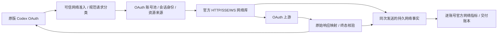

# right-codex

Rust 纯协议网关，固定复用官方 Codex **0.160.0** 源码。运行时不启动 Codex TUI、daemon 或登录子进程。

客户端登录账号和上游账号池均只考虑 **ChatGPT Pro OAuth**。原版客户端保留默认 OpenAI provider，只改 `openai_base_url`。网关使用独立账号池发送模型请求，重建账号、会话与资源身份，再实时映射响应。客户端继续执行工具、子代理、review、Memory、Guardian 和压缩准备。其它套餐及 API Key 专用功能不在实施与验收范围。

当前尚未达到原版Pro OAuth的完整功能与出站等价。首次响应控制头、/models ETag、回包协议身份和遥测资源已有测试证据。业务请求不自动重试或流中切号；上游错误透传，401停止账号调度，429按上游重置时间冷却。路由代次、指标口径等仍待收尾，详见 [PLAN 的收尾顺序](PLAN.md#复审后的具体收尾顺序)。开源和镜像发布不代表这些待办已完成。

## 架构



已接入 Responses HTTP/SSE/WS、预热/中断、V2 压缩、模型目录、条件独立搜索及 OAuth 图片生成/编辑；同时提供 OAuth 登录/刷新、账号管理、容量/排队/休息、排空删除、持久会话恢复和请求之间的账号调度。图片功能受官方 feature、模型、账号权限控制，本次测试账号的生成/编辑及后续对话已通过；其他账号仍受自身权限控制。

客户端原凭据及协议字段中的账号头、线程/轮次/缓存/trace/工具 ID 不直接传到池内上游。外来密文被移除；同号数据只有本网关的来源证明才复用。后续客户端请求换号时新建身份，已观察的明文历史和图片原字节供该新请求使用。只有外部 file_id 或加密历史、没有源内容时，网关没有重建来源。

只改模型 base **不会代理所有客户端流量**：客户端登录、额度、Apps 文件上传、Analytics/OTel、MCP 有独立出口。网关仅登记自己的实际网络事实，不制造客户端工具执行或审批事件。OAuth WebRTC 的 sideband 默认绕过模型 base 并使用客户端自身认证，因此 `realtime/calls`、`live` 在创建前返回双语 501，避免把池内 call ID 与客户端账号关联。

自选的私有 collector 接收网关事实，与官方指标出口分开。遇到 HTTP 结果不明时，网关会在退避后重送未获确认的事实；接收端应以 `account_key` 与稳定的 `fact_id` 去重。HTTP 2xx 仅表示该批请求获响应，不证明每条事实已被单独处理。停用且无活动请求、删除排空结束的账号暂停发送；已有请求在排空期间仍可送出其自身事实。

**文本与协议字段分开处理：** instructions、提示词正文、序列化历史文字中的ID和用户目录都作为普通文本原样保留，不做扫描、改写或额外拒绝。身份隔离针对实际协议字段、请求头、资源引用和原生加密reasoning等数据。

## 本机启动

```bash
cargo build --locked
cp config.example.json config.json
./target/debug/right-codex config.json
```

默认地址：`http://127.0.0.1:18184`；管理页：`http://127.0.0.1:18184/admin`。在配置中设置 `admin_token`，管理页用该值访问管理 API。它是管理口令，不是客户端模型 API Key。

通过管理页新增 OAuth 账号并配置代理；远程管理使用 Device Code。浏览器 PKCE 回调监听网关宿主机的 loopback 1455，已占用时使用 1457，二者都占用则返回明确错误。浏览器须在网关宿主机完成回调。

### Codex2API 管理接口

外部账号管理程序填写网关根地址（默认 `http://127.0.0.1:18184`），管理密码填写配置中的 `admin_token`。三个接口用 `X-Admin-Key` 认证；该头缺省时也接受 `Authorization: Bearer <admin_token>`：

| 方法和路径 | 请求与返回 |
| --- | --- |
| `POST /api/admin/oauth/generate-auth-url` | JSON `{"proxy_url":""}`；返回 `auth_url`、`session_id`、`expires_in_seconds` |
| `POST /api/admin/oauth/exchange-code` | JSON `{"session_id":"…","code":"…","state":"…","name":"账号标签","proxy_url":""}`；返回整数 `id`、`email`、`plan_type`、`updated`、`message` |
| `GET /api/admin/accounts?view=lite&channel=codex` | 返回 `accounts` 数组，包含整数 `id`、`name`、`email`、`plan_type`、`status`、`enabled` |

默认授权回调是 `http://localhost:1455/auth/callback`；由外部程序捕获其中的 code/state 并调用兑换接口，网关不为这些接口启动本地端口监听。可选 `redirect_uri` 仅接受 localhost/127.0.0.1 的1455或1457端口与 `/auth/callback` 路径。

空 `proxy_url` 为直连；兑换时省略该字段则沿用会话代理，显式填写则必须匹配准备阶段。`name` 只作显示标签，邮箱和Pro套餐来自授权凭据。同一workspace重新授权更新已有账号，保持整数ID、管理停用状态及有效429冷却；实际新凭据解除401失效。不同workspace不按邮箱合并。

授权会话和兑换结果在内存中保留15分钟，进程重启后须重新授权；账号凭据和整数ID持久保存。相同授权码重复提交读取已完成结果，进行中的兑换返回409及 `Retry-After: 1`，不会重复向上游兑换。已兑换后若本地写入失败，同一会话有效期内重提原请求只补做本地导入/回执写入。状态包括active、unauthorized、rate_limited、paused、disabled、deleting；enabled保留管理开关，不把401失效冒称管理员停用。列表不返回token或代理密码，使用proxy_configured表示代理绑定，也不触发额度/恢复探测；当前支持lite/codex视图，不包含Codex2API其它管理接口。错误返回HTTP状态及 `{"code":"错误码","error":"English / 中文"}`。

也支持启动时只读导入已有凭据：

```json
{"id":"account-a","auth_path":"/absolute/private/auth.json","proxy":null,"enabled":true}
```

把该对象放进 `config.json` 的 `accounts` 数组。首次导入复制到网关私有状态目录，刷新和后续启动只使用私有副本，不依赖源文件继续存在；显式重新导入仍校验账号身份，不修改原文件。`proxy` 支持 HTTP/HTTPS/SOCKS5/SOCKS5H；`null` 为直连，不继承环境代理。相对路径以配置文件目录为准。

客户端保持自己的 OAuth 登录，在它的配置中加入：

```toml
openai_base_url = "http://127.0.0.1:18184/v1"
```

不添加自定义 model provider。远程客户端把地址换成网关主机。`trusted_networks` 按实际 socket peer/CIDR准入，默认只信任 loopback，忽略转发头；客户端 Bearer 的格式检查不等同于 OAuth 身份认证。网络访问范围由操作员明确设置。

## 调度与持久状态

- 五档容量按账号加入网关后的时长：0–1、1–2、2–4、4–24、24 小时以上，单位是逻辑会话数。
- `idle_timeout_secs` 控制空闲会话回收，`startup_spacing_secs` 控制同账号建立不同会话的间隔。
- 每 X 分钟随机选 Y% 账号暂停接收新会话 Z 分钟；既有活动请求继续完成。
- 单账号即时并发容量与手动休息只作用于当前进程；上面的全局调度配置持久化并在重启后恢复。
- 删除先标为排空，不再接新请求，活动请求释放后移除私有账号凭据。
- 一次业务请求只发送一次上游。所有上游错误保留状态、业务正文和业务头后结束；已有文本/工具不撤回、不接写。协议身份仍按隔离规则处理。
- 401将当前凭据标记失效并持久停调度；重新启用不会解除，须导入实际更新的凭据。429仅在带有效未来重置时间时冷却至指定时刻，没有重置时间不默认冷却。
- 下一次客户端请求才重新选择账号；WS错误交付后关闭，新连接取得新握手信息。客户端自身的重试与网关重试分开记账。旧max_attempts配置仅兼容读取。
- 请求原文及zstd解压后各限64MiB，聚合历史64MiB，持久快照128MiB；到界限返回明确错误。
- 状态目录保存账号、会话来源、图片字节、独立WS连接事实和交付账本；目录 0700、文件 0600。备份必须保护这些凭据与对话数据。停止服务后备份整个目录及配置，恢复时使用对应程序版本；完整state异目录恢复已受控验收。网关创建的账号按明确私有来源标记定位新目录，外部导入路径不自动重写。

## 容器

镜像：[wxyin/right-codex](https://hub.docker.com/r/wxyin/right-codex)。同一标签包含 **Linux x86_64（amd64）和 ARM64**，Docker 按宿主架构拉取。`latest` 跟随最新发布，同时保留 `YYYYMMDDTHHMMSSZ` 格式的 UTC 时间戳标签；固定版本时将 Compose 中的 `latest` 替换为对应时间戳。

```bash
git clone https://github.com/1198722360/right-codex.git
cd right-codex
cp deploy/config.container.example.json config.json
# 编辑 config.json：设置 admin_token 与实际需要的 trusted_networks
./deploy.sh
```

Compose 只有一个服务，数据在 `./state`，端口 18184，管理页为 `http://网关地址:18184/admin`。示例管理密码为 `123456`，在 `config.json` 的 `admin_token` 中设置。脚本准备状态目录权限后执行 `docker compose pull` 和 `docker compose up -d --remove-orphans`，不依赖宿主 Rust 或 Python，也没有初始化容器。容器以 UID 10001 运行，配置文件须对该用户有读取权限。通过管理页的 Device Code 新增账号；默认桥接配置没有把 PKCE loopback 回调发布到宿主。

容器示例的可信 CIDR 是 Docker 私网，部署时须按实际访问边界调整。更新时再次执行 `./deploy.sh`，拉取镜像并重建发生变化的服务；当前脚本不是旧项目的受控无停机升级器。状态目录沿用原目录，升级前按上面的备份说明保存数据。

维护者构建并发布双架构镜像：

```bash
docker login
./scripts/publish-runtime-images.sh
```

发布脚本一次构建 `linux/amd64,linux/arm64`，推送时间戳与 `latest` 两个标签，并核验远端架构清单及两个标签的摘要一致性。构建要求 Docker Buildx 支持这两个平台；`--image`、`--tag` 和 `--builder` 用于指定仓库、发布标签和已有 builder。自行构建且仅供本机使用：`docker build -t right-codex:local .`。

## 开源许可

本项目使用 [Apache License 2.0](LICENSE)。固定导出的 OpenAI Codex 源码保留原始许可和声明，见 [NOTICE](NOTICE)、[上游 LICENSE](vendor/codex/LICENSE) 与 [上游 NOTICE](vendor/codex/NOTICE)。发行镜像也包含这些声明。配置、账号凭据、会话状态和私有验收原包不进入源码仓库或镜像。

## 测试、来源和当前资格

```bash
cargo test --locked --no-fail-fast
cargo clippy --locked --all-targets --no-deps -- -D warnings
python3 scripts/vendor-codex-source.py --check
python3 scripts/verify-profile.py
```

测试脚本中的 Python 只用于审计和源码核验，产品运行时是 Rust。本轮Codex2API接入后的完整215项回归通过，含10项接口集成测试；构建、严格Clippy与原版客户端消费验证见审计文档。正文原样保留与协议身份独立映射继续保留。公开发行已核验当前代码的Linux amd64/arm64容器启动、管理认证、退出及两个架构的匿名拉取；x86_64启动在Docker仿真环境执行。同版本备份恢复、原版普通/工具差分及真实Linux OAuth仍按各自历史快照记录，不自动视为本次重新验收。实际验证进度见 [审计文档](docs/IMPLEMENTATION-AUDIT.md)、[验收清单](docs/ACCEPTANCE.md)。实现、受控测试、真实 OAuth、Linux 双架构与部署分别记录，不把 SDK 局部成功当作所有客户端功能通过。

固定官方提交：`a956835d020762cb2b570053af06f643a11c0ecc`。vendor 独立导出并校验，不读取来源仓库未提交文件；不修改官方源码。原始 [LICENSE](vendor/codex/LICENSE) 与 [NOTICE](vendor/codex/NOTICE) 保留。完整技术合同见 [PLAN](PLAN.md)，逐端点 OAuth 消费者见 [覆盖清单](docs/PROTOCOL-COVERAGE.md)。
